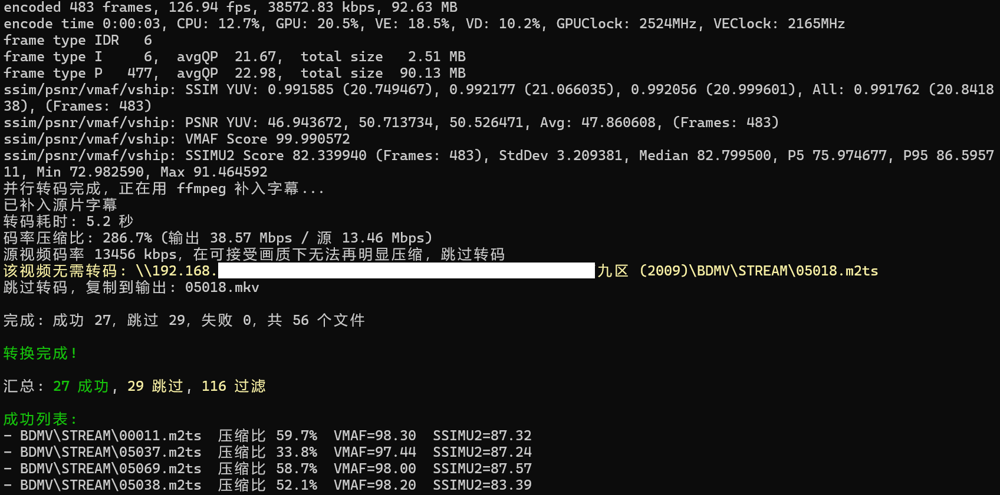

# Huto Video Converter

基于 NVEncC 的视频转码工具，将片源转为 AV1/HEVC + MKV，并复制音轨、字幕、章节与 HDR 元数据。默认用 NVIDIA 硬件编码；胶片颗粒片也可选 SVT-AV1 软件编码。目标是在可接受画质下缩小体积，而不是为了重建颗粒把文件变大。



## 功能特性

- **硬件加速**：默认 NVEncC AV1（`preset=quality` + `tune=uhq` + `--parallel auto`）
- **可选软件编码**：`--encoder svt_av1`（`tune=0`，关闭颗粒合成）
- **输入**：蓝光目录 (BDMV)、电视剧目录、单文件/单目录；MKV、MP4、TS、M2TS 等
- **蓝光**：识别播放列表与章节 (MPLS)，按体积最大的正片优先处理；正片转成功才处理花絮（花絮无需转码则复制到输出）；正片无需转码则整盘跳过、正片失败则整盘失败。默认过滤过小的 STREAM 片段（片头 logo、声明等），可用 `--min-bluray-size` 调整
- **轨与元数据**：拷贝音轨、字幕、章节、HDR10 / Dolby Vision RPU（NVENC）；PGS 字幕在并行编码完成后由 FFmpeg 补入
- **NFO**：仅当片源有同名 NFO 时才输出 NFO（复用影片信息并只替换 `fileinfo`）；没有则不生成。蓝光根目录内与目录同名的 NFO 给正片用，并保持文件名。复制跳过的视频时，同目录同名 NFO 一并复制。可用 `--force-nfo` 强制生成：片源有 NFO 则照旧复用，没有则基于成片信息生成一个新的 NFO
- **自动质量**：未指定 `-q` 时对中间约 20 秒试片二分搜索。达标且体积小于片源则转；只达最低门槛但仍能缩小则转；否则跳过
- **启动检查**：开始压片前确认 NVEncC 9.33+、ffmpeg、ffprobe；`svt_av1` 还要求 ffmpeg 带 `libsvtav1`
- **成片对账**：转码成功后对比源片与成片的色彩标签（primaries / transfer / matrix / range，有则再看 mastering / MaxCLL）；丢失只警告，不把整次标失败
- **中断**：Ctrl+C 会结束子进程、删除不完整的 mkv/nfo，退出码 130
- **汇总**：成功/跳过/过滤/失败按文件列出（相对你指定的输入路径），成功条目带压缩比、VMAF、SSIMU2；小于 `--min-bluray-size` 的蓝光片段单独进过滤列表；任务输出目录写入 `convert_result.json`

## 环境要求

- **硬件**：NVENC 需要 NVIDIA 显卡（AV1 需 Ada 或更新）；`--encoder svt_av1` 走 CPU
- **软件**：
  - [uv](https://docs.astral.sh/uv/)（Python 3.12）
  - [NVEncC](https://github.com/rigaya/NVEnc) **9.33+**（加入 PATH，或 `--nvenc-path`）
  - FFmpeg（`ffmpeg`、`ffprobe`；`svt_av1` 需带 `libsvtav1`）
  - NVENC API 13.1 对应的显卡驱动（仅软件编码时可忽略）

## 安装

1. 安装 [uv](https://docs.astral.sh/uv/getting-started/installation/)。
2. 安装 [NVEncC](https://github.com/rigaya/NVEnc/releases)，将 `NVEncC64.exe` 所在目录加入 PATH，或运行时用 `--nvenc-path`。
3. 克隆本项目：

```bash
git clone https://github.com/sjh00/huto_video_converter.git
cd huto_video_converter
```

`uv run` 会自动准备 Python 3.12 环境。

## 使用方法

```bash
uv run video_converter.py [输入...] [选项]
```

未指定输入时，检测项目根目录 `input/` 是否有视频或蓝光目录，并询问是否批量转码。也可显式传入 `input` 作为输入名，此时不询问、直接处理该目录。

### 参数

| 参数 | 说明 |
|---|---|
| `input` | 视频文件或目录，可多个。蓝光可传根目录或 `BDMV` |
| `-o`, `--output` | 输出文件或目录。多输入时必须是目录 |
| `-e`, `--encoder` | `av1_nvenc`（默认）、`hevc_nvenc`、`svt_av1` |
| `-q`, `--qvbr` | 质量值。NVENC 为 QVBR，SVT-AV1 为 CRF。省略则自动搜索 |
| `-v`, `--enable-quality-eval` | 成片时计算 VMAF / SSIMU2 / SSIM / PSNR（自动选质量时试片总会算 VMAF/SSIMU2） |
| `-p`, `--nvenc-path` | `NVEncC64.exe` 路径 |
| `-n`, `--no-qp-max-limit` | 不设 `qp-max`，允许 QVBR 再降码率 |
| `-t`, `--test` | 只转中间约 20 秒，仅单个视频文件 |
| `-z`, `--keep-default-zh-audio` | 只复制默认音轨和国语音轨 |
| `--keep-grain` / `--no-keep-grain` | 是否保颗粒与纹理（默认开）。NVENC 关闭 UHQ 时域滤波；SVT-AV1 使用 VQ 且关闭颗粒合成 |
| `--min-bluray-size` | 蓝光 STREAM 过滤阈值（MB）。**小于**该体积的片段自动过滤，**等于**该体积的仍会处理。默认 `40`。设为 `0` 则不按体积过滤 |
| `--force-nfo` | 强制生成 NFO 文件。默认仅当片源有同名 NFO 时复用并更新 `fileinfo`；开启后，若片源没有 NFO 则基于成片信息生成一个新的 NFO |

### 蓝光片源处理

可传入蓝光根目录或其中的 `BDMV` 目录。工具会识别 `BDMV/STREAM` 与 `PLAYLIST`，按下面顺序处理：

1. **解析播放列表 (MPLS)**：用单片段播放列表对应各 `*.m2ts`；读章节、音轨/字幕语言。没有可用播放列表时，回退为扫描全部 STREAM 文件。
2. **过滤过小片段（默认开启）**：体积**小于** `--min-bluray-size`（默认 40 MB）的 STREAM 文件不转码、不复制，并单独列入「过滤列表」。这些短片一般是片商 logo、反盗版声明、工作室标识等，没有收藏价值。体积**正好等于**阈值的文件仍会处理。`--min-bluray-size 0` 关闭这项过滤，所有片段都进入后续流程。
3. **正片优先（与有没有 NFO 无关）**：剩余片段按文件体积从大到小排，最大的当正片先转。
   - 正片**转成功**才继续花絮。花絮无需转码则复制到输出（同目录同名 NFO 一并复制），避免输出目录缺文件。
   - 正片**无需转码**则整盘跳过，不复制正片和花絮。
   - 正片**失败**则整盘失败，停止花絮。
4. **同名 NFO**：蓝光根目录内有与目录同名的 `.nfo` 时，正片复用它并保持文件名、只替换 `fileinfo`。
5. **字幕**：PGS 等字幕不在 NVEncC 并行编码时拷入，成片后再用 FFmpeg 从原盘补入。
6. **输出**：在输出目录下建与蓝光根目录同名的文件夹，正片/花絮写成 `.mkv`。

过滤掉的过小片段出现在处理过程中的过滤列表、任务结束时的汇总，以及 `convert_result.json`（`status: filtered_small`）。复制到输出的跳过文件在跳过列表中标注「已复制」。

### 跳过与复制

按**任务类型**决定无需转码时要不要把源文件复制到输出：

| 任务 | 无需转码时 |
|---|---|
| 单个视频文件 | 不复制。结果里会写明跳过 |
| 单影片目录（目录里只有一个视频） | 不复制 |
| 蓝光目录 | 正片跳过 → 整盘跳过、不复制。正片已转成功 → 花絮跳过则复制到输出（补全输出目录） |
| 电视剧（季目录或多个视频） | 先记下跳过、不立刻复制。连续 3 集跳过且此前没有转码 → 判定该季无需转码，整季跳过、不复制。若该季已有转码 → 处理完后再把跳过的集复制到输出 |

多个任务时，每个任务各自按上表处理：单文件任务不复制；目录任务里的子目录本身不整夹复制，其中需要补全输出的视频才会复制。

### 自动质量门槛

目标/最低分对齐 certification：VMAF 97.3 / 93.0，SSIMU2 87.1 / 80.0。达不到最低分且体积无法明显压缩则跳过。

| | `--keep-grain` | `--no-keep-grain` |
|---|---|---|
| 目标 VMAF / 最低 VMAF | 97.3 / 93.0 | 97.3 / 93.0 |
| 目标 SSIMU2 / 最低 SSIMU2 | 87.1 / 80.0 | 87.1 / 80.0 |
| NVENC 搜索范围 (QVBR) | 10–30 | 18–34 |
| SVT-AV1 搜索范围 (CRF) | 18–32 | 24–38 |

先选「达标且更小」中压缩最多的；没有则选「可接受且更小」中更接近目标的。QVBR/CRF 越大通常体积越小。这些目标/最低分会写入 `convert_result.json` 的 `quality_search`。

### 使用示例

1. **单文件，默认 AV1 NVENC、自动质量、保颗粒**

```bash
uv run video_converter.py movie.mkv
```

2. **指定输出文件或目录**

```bash
uv run video_converter.py movie.mkv -o "E:\Converted\movie.mkv"
uv run video_converter.py movie.mkv --output "E:\Converted"
```

3. **HEVC NVENC**

```bash
uv run video_converter.py movie.mkv --encoder hevc_nvenc
```

4. **SVT-AV1（软件）**

```bash
uv run video_converter.py movie.mkv --encoder svt_av1
```

自动 CRF 与跳过规则同 NVENC。可用 `-q` 指定 CRF，例如 `-q 16`。保留 HDR10 色度；杜比视界 RPU 不能像 NVENC 那样原样复制。

5. **指定质量，跳过自动搜索**

```bash
uv run video_converter.py movie.mkv --qvbr 22
uv run video_converter.py movie.mkv -e svt_av1 -q 16
```

6. **关闭保颗粒（UHQ 原时时域滤波，搜索更偏压缩）**

```bash
uv run video_converter.py movie.mkv --no-keep-grain
```

7. **成片输出质量分数**

```bash
uv run video_converter.py movie.mkv --enable-quality-eval
```

8. **指定 NVEncC 路径**

```bash
uv run video_converter.py movie.mkv --nvenc-path "E:\software\NVEncC\NVEncC64.exe"
```

9. **不限制 qp-max**

```bash
uv run video_converter.py movie.mkv --no-qp-max-limit
```

10. **只转中间 20 秒做试验**

```bash
uv run video_converter.py movie.mkv --test
uv run video_converter.py movie.mkv -t -o "E:\Converted\movie_test.mkv" -q 22 -v
```

11. **只保留默认音轨和国语**

```bash
uv run video_converter.py movie.mkv --keep-default-zh-audio
```

12. **蓝光目录**（默认过滤小于 40 MB 的 logo / 声明片段）

```bash
uv run video_converter.py "D:\Movies\Avatar BluRay"
uv run video_converter.py "D:\Movies\Avatar BluRay\BDMV"
```

13. **蓝光：自定跳过阈值，或不过滤小片段**

```bash
uv run video_converter.py "D:\Movies\Avatar BluRay" --min-bluray-size 50
uv run video_converter.py "D:\Movies\Avatar BluRay" --min-bluray-size 0
```

14. **电视剧目录**

```bash
uv run video_converter.py "D:\TV\某剧" -o "E:\Converted"
```

15. **批量多个输入（输出必须是目录）**

```bash
uv run video_converter.py movie1.mkv movie2.mkv "D:\Movies\某蓝光" -o "E:\Converted"
```

16. **处理项目 `input/` 目录**

```bash
uv run video_converter.py
uv run video_converter.py input
```

17. **组合示例**

```bash
uv run video_converter.py "\\NAS\电影\某片 (2022)" -o "E:\Converted" -e av1_nvenc -q 22 -v -p "E:\software\NVEncC\NVEncC64.exe" -n -z --keep-grain
```

## 质量评估说明

自动选质量时会对试片计算 **VMAF** 和 **SSIMU2**（NVENC 由 NVEncC 计算；SVT-AV1 用 FFmpeg 算 VMAF）。加上 `-v` 后，成片过程也会输出这些分数（NVENC 另有 SSIM、PSNR）。

- **VMAF**（0–100）：偏整体观感。分数高仍可能把颗粒、编织纹、胶片噪点抹平，不能单独当保纹理的依据。
- **SSIMU2**（SSIMULACRA2，大约 0–100）：比 VMAF 更敏感于模糊和纹理损失。保颗粒时用作防「看起来分高、细节没了」的门槛。
- **SSIM**（0–1）：结构相似性，越高越好；同样偏平滑，不单独用来保颗粒。
- **PSNR**（dB）：像素误差，越高越好；同样不适合单独判断胶片颗粒。

决策只用 VMAF + SSIMU2 和体积比，不用 PSNR/SSIM 做门槛。

任务结束后在输出目录写 `convert_result.json`：每条路径的状态（成功 / 跳过 / 过滤过小片段 / 失败）、压缩比、VMAF、SSIMU2、QVBR/CRF，以及本次使用的目标分/最低分。终端汇总不变。

## 许可证

本项目采用 [MIT License](LICENSE)。
